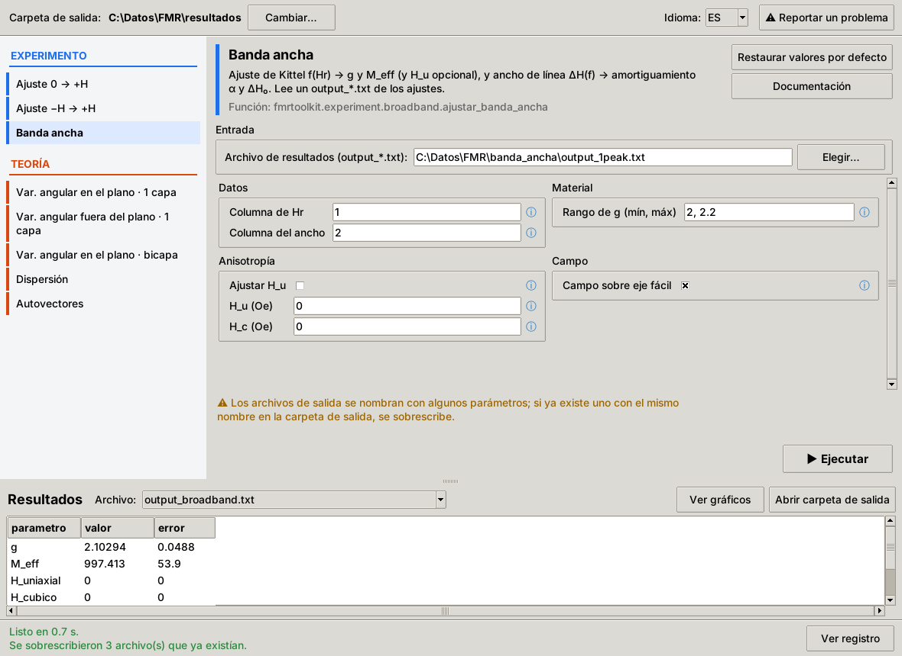
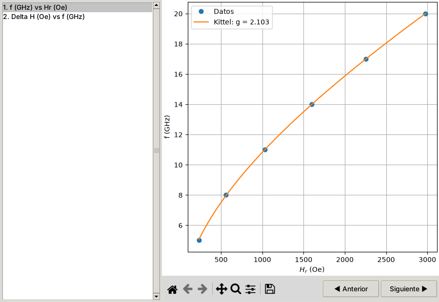

# Graphical interface (`fmrtoolkit.gui`)

A tkinter window to use every public function of the toolkit without writing code.
It does not implement any physics: it collects the parameters, calls the same
functions described in this documentation and shows their results.



## Launching

```bash
python -m fmrtoolkit.gui
```

or `python main.py` from the root of the repository. No extra packages are needed:
tkinter comes with Python (on Linux it may need the system package `python3-tk`).

The first time, the GUI asks for an **output folder**: every table, plot and GIF is
written there.

## Parts of the window

| Part | What it does |
|---|---|
| **Top bar** | Output folder (always visible, *Change…*), language selector ES/EN (applied immediately) and **Report a problem** |
| **Left sidebar** | The techniques, in two sections: *Experiment* (blue) and *Theory* (orange). Hover over a name to see what it does |
| **Form** | Input (folder or `output_*.txt` file, if the technique needs one) and the parameters, grouped in *Data*, *Fit*, *Material*, *Anisotropy*, *Field* and *Simulation*. Numerical-precision parameters are in the collapsible **Advanced** block |
| **ⓘ icons** | Hover over them (or over the label) for a tooltip: description, unit, formula, name of the Python parameter and the warnings of the documentation |
| **Restore defaults** | Puts back the default values, read from the signature of the function |
| **Documentation** | Opens the page of this documentation for the technique |
| **Run** | Validates the fields and runs the calculation in the background. While it runs, *Running…* is shown and the button is disabled |
| **Results** | Table with the `.txt` files produced by the run (choose the file in the selector), *Show plots*, *Open GIF* (eigenvectors) and *Open output folder* |
| **Status bar** | Time, warnings printed by the function (for example "g ended at the limit") and overwritten files. *Show log* shows the full console output of the last run |

### Techniques

| Sidebar entry | Function | Input |
|---|---|---|
| Fit 0 → +H | [`fit_positive.ajustar_carpeta`](experiment/fit_positive.md) | folder with spectra |
| Fit −H → +H | [`fit_bipolar.ajustar_carpeta`](experiment/fit_bipolar.md) | folder with spectra |
| Broadband | [`broadband.ajustar_banda_ancha`](experiment/broadband.md) | `output_*.txt` |
| In-plane angular · single layer | [`variacion_angular_ip`](theory/single_layer.md) | `output_*.txt` |
| Out-of-plane angular · single layer | [`variacion_angular_op`](theory/single_layer.md) | `output_*.txt` |
| In-plane angular · bilayer | [`variacion_angular_ip_bicapa`](theory/bilayer.md) | `output_*.txt` |
| Dispersion (single layer / two layers) | [`dispersion_1capa`, `dispersion_2capas`](theory/dispersion.md) | none |
| Eigenvectors (single layer / bilayer) | [`autovectores_1capa`, `autovectores_bicapa`](theory/eigenvectors.md) | none |

Dispersion and eigenvectors have a selector at the top of the form to choose between the
single-layer and the two-layer function.

### Units in the form

The form uses the units of the [conventions](conventions.md), except two that are more
convenient to type and are converted before calling the function:

| Quantity | In the form | Passed to the function |
|---|---|---|
| Frequency (theory) | **GHz** | Hz |
| Thickness | **nm** | cm |

Decimal comma or point are both accepted (`9,76` or `9.76`). Lists are typed separated by
commas: Hr columns `1, 3`, g range `2.0, 2.2`, extensions `.dat, .txt`.

### Validation and warnings

Before running, every field is checked (valid numbers, positive steps, `n_lineas` 1 or 2,
field margin larger than the field step in the out-of-plane calculation, minimum field
smaller than maximum, etc.). Fields with errors turn red with the reason below.

Orange warnings appear in the cases the documentation marks as problematic: hard axis in
broadband (formula pending revision), A < 0 in bilayers (mode names inverted) and files
that are overwritten when the same name is repeated.

## Plots



All the figures of a run open in **one** separate window, with the matplotlib toolbar
(zoom, pan, save). When there are many (a folder fit gives one per spectrum), they are
listed on the left and can be browsed with *Previous / Next* or the arrow keys. In the
window the figures are re-arranged to fit its size; the files saved in the output
folder are not affected.

The eigenvector GIF opens with the image viewer of the operating system (*Open GIF*).

## Errors and problem reports

If a calculation fails, a dialog shows a short message with **Show details** (full
traceback) and **Report this error**.

**Report a problem** (top bar) opens a form with two types: *the program gave an error* or
*the result looks wrong (no error)*. It attaches, editable before sending: technique and
parameters, input and output paths, traceback, console output of the last run, versions
of fmrtoolkit (and git commit), Python, numpy, scipy, sympy, matplotlib and the operating
system. *Open email to send* opens the user's email program with a `mailto:` link; nothing
is sent automatically and no password is stored. If the report is too long for a link,
the full report is saved as `reporte_fmrtoolkit_<date>.txt` in the output folder and the
email asks to attach it.

The destination address is `CORREO_REPORTES` in `fmrtoolkit/gui/configuracion.py`.

## What is remembered between sessions

Output folder, language, last technique, last input of each technique and the last
parameters of each technique are saved in `~/.fmrtoolkit/gui_config.json` (the variable
`FMRTOOLKIT_GUI_CONFIG` can point to another file). If that file is damaged or from an
old version, the defaults are used.

## For developers

### Structure

| File | Contents | Uses tkinter |
|---|---|---|
| `especificaciones.py` | Declarative description of every technique (`Tecnica`, `Variante`, `Parametro`, `Advertencia`) | no |
| `conversion.py` | Reading of the fields, GHz↔Hz and nm↔cm, validation | no |
| `configuracion.py` | Settings file, `CORREO_REPORTES` | no |
| `reporte.py` | Report text, environment versions, `mailto:` link | no |
| `ejecucion.py` | Runs a function capturing stdout/stderr/warnings, figures and produced files; background thread | no |
| `idioma.py`, `i18n/es.json`, `i18n/en.json` | All the texts, including tooltips | no |
| `app.py` | Main window | yes |
| `formulario.py`, `widgets.py`, `resultados.py`, `graficos.py`, `dialogos.py` | Form, tooltip and other widgets, results table, plot viewer, dialogs | yes |

**Threads and matplotlib.** The backend is set to `Agg` before importing the toolkit.
Calculations run in a background thread and create figures with pyplot without ever
touching Tk; the result is put in a queue that the main thread checks with `root.after`
(tkinter is not thread-safe). The figures are then embedded in the main thread with
`FigureCanvasTkAgg`. To get the figures, the functions accept an optional
`figuras=[]` list (see [conventions](conventions.md#plots)).

### Adding a technique

1. Make sure the function has `graficar`, `figuras` and an output folder parameter
   (`carpeta_salida`, or `carpeta`), and default values for every parameter.
2. Add a `Tecnica` (with one or more `Variante`) to `TECNICAS` in `especificaciones.py`:
   function, input, output parameter and the list of `Parametro` (group, type, unit,
   conversion factor, advanced or not).
3. Add its texts (name, description, and labels/tooltips of new parameters) to **both**
   `i18n/es.json` and `i18n/en.json`.

No change to the window is needed. The default values are read from the signature with
`inspect.signature`, so they never get out of sync.

### Tests

```bash
python -m unittest discover tests
```

They check, among other things, that every parameter of the specifications exists in the
signature of its function (and that every parameter of the signature is in the GUI), that
both languages have the same keys, the unit conversions, the settings file and the
report. A slower smoke test runs every technique with synthetic data:

```bash
FMR_TESTS_LENTOS=1 python -m unittest tests.test_humo_tecnicas
```

(on Windows: `set FMR_TESTS_LENTOS=1` and then the command).
